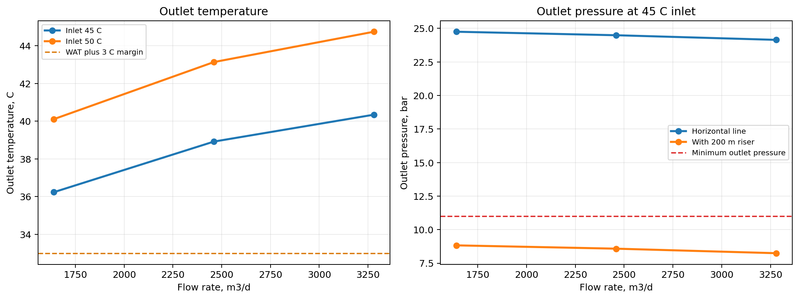
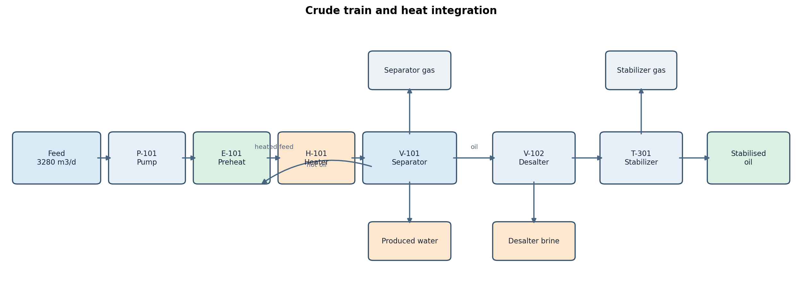
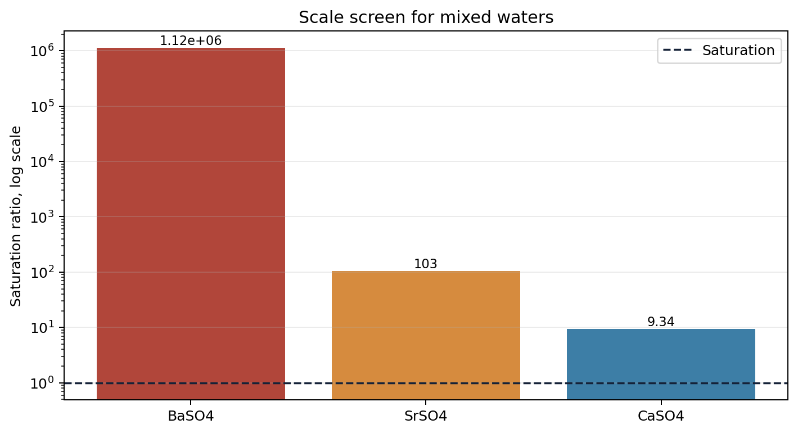

# Process engineering portfolio

Three Python case studies for waxy crude flow assurance, crude separation and production chemistry. Each project uses sourced data, tested arithmetic and a generated dashboard.

Open [portfolio_index.html](portfolio_index.html) for the visual index.

## 1. Waxy crude flow assurance

Screens a subsea line for wax margin, pressure loss and thermal limits. The model uses published crude properties and field geometry, then checks the hydraulic solver against Hagen-Poiseuille and Colebrook. It reports a data gap honestly: 25 bar inlet cannot supply 16 bar riser static head and still leave 11 bar outlet.



Read the [case study](waxy-crude-flow-assurance/README.md) or open the [dashboard](waxy-crude-flow-assurance/dashboard.html).

## 2. Crude separation flowsheet

Pumps, preheats, separates, desalts and stabilises 3280 m3/d of crude. Mass balance closes within 1e-9 and energy balance within 1e-6. A water cut rise from 20 percent to 30 percent raises separator water rate and heater duty.



Read the [case study](process-flowsheet-simulator/README.md) or open the [dashboard](process-flowsheet-simulator/dashboard.html).

## 3. Production chemistry toolkit

Checks water analysis quality, sulfate scaling, mixing compatibility, carbonate tendency and treatment train arithmetic. Published brines are used for the analysis. The Canyon Sands water closes charge balance within 0.5 percent. A 50:50 mix of high barium formation water and Barton seawater gives about 1869 mg/L of barite precipitate in the screen.



Read the [case study](production-chemistry-toolkit/README.md) or open the [dashboard](production-chemistry-toolkit/dashboard.html).

## Certificates

The [certificate index](certificates/index.html) lists 23 Coursera course certificates and 48 AIChE, SAChE and RAPID certificate PDFs. Each entry links to the full PDF.

## Academic documents

The site publishes redacted public copies of the [academic transcript](documents/academic_transcript.pdf) and [degree certificate](documents/degree_certificate.pdf). Redactions hide registration numbers, date of birth, student identifiers and certificate serial numbers.

## Current application documents

The current [CV](documents/cv_totalenergies_junior_process_engineer.pdf) and [cover letter](documents/cover_totalenergies_junior_process_engineer.pdf) attached to the TotalEnergies Junior Process Engineer application are published here.

## Run locally

Each project has no third party requirement beyond Python 3.9 and matplotlib for figures. Run from each project folder:

```bash
python -m pytest -q
python scripts/build_dashboard.py
```

The dashboard script regenerates all figures before writing `dashboard.html`.

## Limits

I do not claim field pressure validation. I do not claim PRO/II or UniSim use. Treatment removal fractions and several hydraulic constants are labelled assumptions. Source gaps are stated in each project README.
